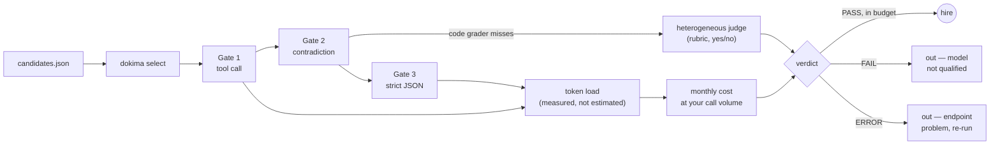

<p align="center">
  
</p>

<h1 align="center">dokimasia</h1>

<p align="center">
  <strong>AI model vetting, in three gates. Leaderboards set expectations;<br>money is spent only after live probing on your own stack.</strong>
</p>

<p align="center">
  <a href="https://www.python.org/"></a>
  &nbsp;
  <a href="LICENSE"></a>
  &nbsp;
  
</p>

**No manual required: set your key, run one command, read the verdict.**
Dokimasia examines AI models for a live role: a three-gate smoke exam on any
OpenAI-compatible endpoint, real token load measured (not estimated), monthly
cost computed from your actual call volume, and — with `select` — a candidate
list scanned and the hire decision issued automatically.

**Status:** Early version. A live exam against a real endpoint has not been
run yet; the demo output below is illustrative. Model names and prices in
examples are illustrative.
**Scenario and data:** Exam prompts are fictional. No real client, employer,
case number, or platform appears in any content.

## How it works



`select` never confuses a broken endpoint with a bad model: ERROR and FAIL
are different exits, and an all-ERROR batch means *fix the endpoint and
re-run* — never *change the conclusion*.

## Example run (illustrative output)

```
$ dokima select --candidates candidates.json --calls 100 --budget 300

  [PASS] vendor-a/model-flash -> lowest measured monthly cost
  [PASS] vendor-b/model-lite

==== DECISION ====
Hired: vendor-a/model-flash (lowest measured monthly cost, 347+86 tokens/call)

Report: dokima-reports/select-20261021-1920.md
```

## Quickstart

```bash
# any OpenAI-compatible endpoint + your key
export DOKIMA_ENDPOINT="https://your-endpoint.example.com/v1"
export PROCTOR_API_KEY="sk-..."

# full auto-selection: scan candidates, examine each, price each, issue the hire
python3 dokima.py select --candidates examples/candidates.json --calls 100 --budget 300
```

Or examine a single model first:

```bash
python3 dokima.py exam --model MODEL_ID --judge JUDGE_ID
python3 dokima.py estimate --model MODEL_ID --calls 100 --price-in 0.11 --price-out 0.51
python3 dokima.py wizard          # five questions, exam + decision record
```

## The four commands

| Command | What it does | Output |
|---|---|---|
| `exam` | Three-gate smoke exam on one model | PASS / FAIL / REVIEW + report file |
| `estimate` | Measures real token load once, prices your monthly volume | US$/NT$ monthly cost |
| `wizard` | Five questions → exam + auto-generated decision record | Decision record (MD) |
| `select` | Scans a candidate list: examines, measures, prices, decides | Hire + ranked report (MD) |

- **`select` candidates JSON:** `[{"model":"...","price_in":0.11,"price_out":0.51}]`
  — unpriced candidates are still examined, ranked after priced ones
- **Credentials:** read from `PROCTOR_API_KEY` (fallback `OPENAI_API_KEY`); never enters prompts, never printed
- **Endpoint:** any OpenAI-compatible `/v1` URL, via `DOKIMA_ENDPOINT` or `--endpoint`
- Each exam is a small token load; the tool measures and reports it rather than estimating. `--judge` is a heterogeneous second reviewer: a model from a different family grades rubric answers the literal grader cannot catch
- UI strings and exam prompts are English

## Background / Why this exists

Leaderboards tell you who is smart. Dokimasia tells you whether a model, on
your endpoint, at your price, in your job, breaks in ways you cannot afford.
The three gates map to three real failure modes:

1. **Tool call** — the model must call the given function with the given arguments. Broken tool calls kill automation.
2. **Contradiction** — two conflicting rules are given; the model must flag the conflict instead of answering anyway. Swallowing contradictions produces fake completion.
3. **Structured output** — the model must return exactly the required JSON. Promised JSON delivered as prose ruptures pipelines.

## Limits

- One run per gate in v0.1 of the flow; stability across repeated trials is not yet automated
- Verdicts hold for the tested endpoint and persona at test time; floating model tags drift — pin dated model ids in production
- The rubric judge is itself a model; its task is deliberately narrow (yes/no conflict detection) to limit judge error
- Not a benchmark. No leaderboard claims, no invented results

## Contents

```
dokimasia/
├── dokima.py              # the whole tool (Python 3.10+, stdlib only)
├── docs/logo.png          # mark
├── examples/candidates.json
├── manifest.json          # publication record
├── LICENSE                # MIT
└── README.md
```

## License

MIT — see [LICENSE](LICENSE).

---
