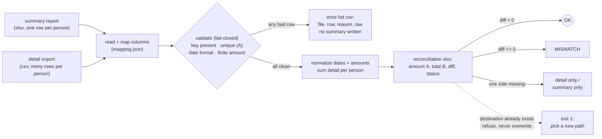
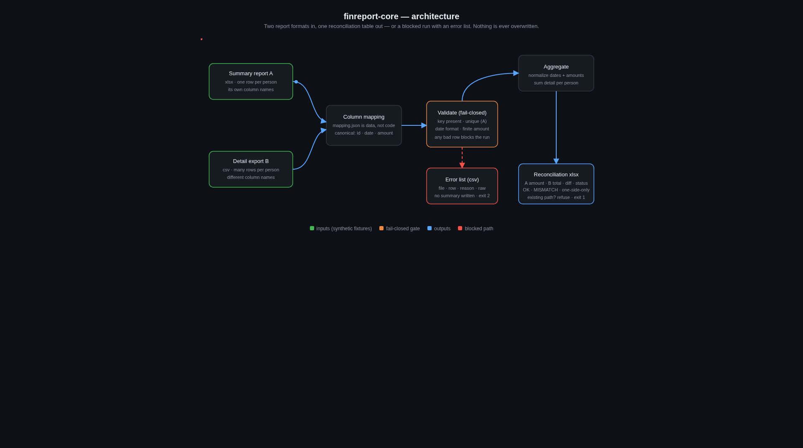

<h1 align="center">finreport-core</h1>

<p align="center">
  <strong>Merge the same numbers from two different report formats,<br>fail closed when the input is dirty.</strong>
</p>

<p align="center"><a href="#architecture">Architecture</a> · <a href="#quickstart">Quickstart</a> · <a href="#acceptance-tests">Tests</a></p>

<p align="center">
  <a href="https://www.python.org/"></a>
  &nbsp;
  <a href="LICENSE"></a>
  &nbsp;
  
</p>

**One command, one reconciliation table.** An operations team closes the month
with the same figures arriving in two shapes: a summary sheet (xlsx) with one
row per person, and a detail export (csv) with many rows per person and
different column names. Joining them by hand is slow and errors slip through.
finreport-core maps both to one canonical schema, normalizes dates and
amounts, sums the detail side, and writes a reconciliation table with an
explicit diff and status per person. When a row has a missing or duplicate
key, a bad date, or a bad amount, the run blocks: no summary is written, and
every bad row is listed with its file, row number, reason, and raw content.
It also never overwrites or deletes existing files — if the output path
already exists, it refuses and asks for a new one, so a stale result can
never be mistaken for this run's output.

**Status:** v0.2. Acceptance suite (17 checks) passes in this workspace;
1,000 detail rows merged in ~0.2s on this machine (local measurement on
synthetic data, not a performance commitment).
**Scenario and data:** all fixtures are synthetic and deterministically
generated (fixed seed). No real client, employer, case number, or platform
appears in any content.

## How it works



The mapping is data, not code: adapting to two new report layouts means
editing `mapping.json`, not the tool.

## Architecture

<p align="center">
  
</p>

The animated version lives at [`docs/architecture.html`](docs/architecture.html) —
download it and open it in a browser (GitHub shows the source, not the
rendered page).

## Quickstart

```bash
pip install openpyxl        # the only third-party dependency
python3 gen_fixtures.py     # regenerate the synthetic fixtures + answer key
python3 finreport_core.py mapping.json \
    fixtures/fixture_A_summary.xlsx fixtures/fixture_B_detail.csv \
    evidence/out_summary.xlsx evidence/err.csv   # both paths must be new
```

## Acceptance tests

```bash
python3 run_tests.py        # writes to a fresh evidence/run-<timestamp>/ each time
```

| Test | What it proves |
|------|----------------|
| T1 | Happy path: exit 0, all 50 people reconcile column-exactly against the answer key, detail grand total 5,003,005; 1,000 detail rows merged |
| T2 | Missing key blocks: 3 planted rows with an empty ID produce exit 2, an error list of exactly 3 rows, and no summary file |
| T3 | Bad format blocks: a bad date and a bad amount produce exit 2 with exactly those 2 rows listed, no summary |
| T4 | Offline: all sockets disabled in-process, exit 0 — no network dependency |
| T5 | Destination protection: existing summary or error-list path produces exit 1, nothing overwritten or deleted |
| T6 | Duplicate key in A blocks: exit 2, the duplicate ID listed, no summary |
| T7 | Non-finite amounts (nan/inf/-inf) block: exit 2, all 3 listed, no summary |

Latest run output: [`evidence/test_output.txt`](evidence/test_output.txt).

## Layout

- `finreport_core.py` — the tool (pure rule engine, ~100 lines)
- `mapping.json` — column mapping for the two fixture formats
- `gen_fixtures.py` — deterministic synthetic fixture generator (fixed seed)
- `run_tests.py` — acceptance tests T1–T7
- `fixtures/` — synthetic data (1,000 detail rows, 50 summary rows, answer key)
- `evidence/test_output.txt` — latest local test run
- `docs/architecture.html` — interactive architecture diagram

## License

MIT. See [LICENSE](LICENSE).
