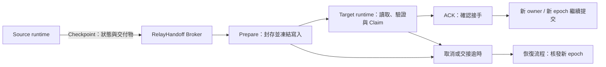

# RelayHandoff

### 讓任務的狀態、執行權與證據，不再綁在一次會話或一個 runtime。

RelayHandoff 把「做到哪裡、誰有權繼續、帶走哪些交付物、接手是否成立」做成一套獨立於模型與 runtime 的可執行協定。

**Handoff 是其中一個動作；任務的連續性才是要解決的問題。**

> **產品定位工作稿**：跨 runtime 的任務連續性控制層（Task Continuity Control Layer）。這是目前的架構描述，不是已定稿的市場分類或銷售標語。品牌敘事與賣點由同儕共同定稿；功能承諾必須對應實作與驗收。

[快速體驗](#快速體驗) · [運作方式](#運作方式) · [驗收證據](#驗收證據) · [動態圖協作](docs/MOTION_BRIEF.md) · [API 契約](PROTOCOL.md) · [商業交付](COMMERCIAL.md)

## 我們不是只想把對話搬到另一個視窗

當一件工作跨越會話、工具或執行環境，真正需要延續的不只是摘要：

| 任務要回答的問題 | RelayHandoff 現在提供的控制 |
|---|---|
| 做到哪裡，哪些結果已經存妥？ | 持久化 checkpoint、revision 與附件 |
| 目前誰能提交下一個結果？ | owner lease、遞增 fencing epoch 與 revision CAS |
| 原執行者與接手者會不會同時寫？ | Broker 內交易裁決；交接期間凍結寫入 |
| 接手者拿到的是不是同一份內容？ | bundle 與二進位附件 SHA-256 驗證 |
| 接單就等於已經可以繼續嗎？ | claim 與 ACK 分開，確認後才開放 Broker 寫入 |
| 遷移失敗、程序退出或服務重啟怎麼辦？ | 持久化狀態、取消、租約到期與交接逾時恢復 |
| 事後能否回查發生了什麼？ | tenant-scoped 稽核事件與接手回執 |

**它保存的是可恢復的工作狀態，協調的是提交權，留下的是可以核對的交接證據。**

這些控制目前作用在 Broker 管理的狀態與交付物。對外部 Git、SQL 或社群 API 的副作用，仍須由 adapter 與目的端提供條件寫入或防重機制；不能把這張表讀成全系統 exactly-once 保證。

## 適合什麼工作

- **長任務續作**：會話換了，保留 checkpoint、交付物與恢復依據，不只靠一段摘要。
- **跨 runtime 接力**：執行環境不同，仍用同一份 HTTP 契約移交狀態與提交權。
- **執行與驗證分離**：builder 交付、reviewer 驗證輸入，再明確 ACK 與提交驗收結果。
- **失敗後恢復**：舊執行者的租約失效後，讓新的 owner 接續 Broker 內工作，不讓舊 token 恢復寫入權。

前述是設計用途，不代表所有 IDE、Agent 框架或作業系統均已整合。**現有跨 runtime 實證是 Linux 上 Python 與獨立 Node.js 程序；其他 runtime 需要 adapter。**

## 運作方式



這不是搬移正在運作的 OS process。Source adapter 必須先停在安全邊界、完成 checkpoint，再開始交接；Target adapter 必須驗證輸入與自身能力，才 ACK。

### 三件事必須分開

1. **內容已保存**：checkpoint 與附件已進 Broker。
2. **接手已確認**：Target 驗證輸入後送出 ACK。
3. **工作已完成**：Target 繼續執行並提交可驗收結果。

Claim 不是 ACK，ACK 也不是任務完成。協定不能證明模型「理解了」任務，也不會自動繼承模型權限、憑證或 OS 權限。

## 快速體驗

從這個 repo 的根目錄進入產品目錄：

```sh
cd relayhandoff
python launch.py
```

需求：Python 3.10+，僅用標準函式庫，不需安裝 Python 套件。Linux/macOS 常用 `python3`，Windows 可用 `py`；命令相容不等於已完成該 OS 實機認證。

啟動器會建立本機 SQLite 與 scoped keys，在 loopback 啟動控制台，並開啟瀏覽器。控制台可建立任務、寫 checkpoint、封存、接手與讀取稽核。

### 看一場真的 Python → Node.js 接力

另需 Node.js 18+：

```sh
python demo.py
```

這個 demo 會實際執行：

1. Python 寫入 checkpoint 與繁體中文附件。
2. Broker 封存交接內容，凍結原 owner 的寫入。
3. 獨立 Node.js 程序驗證 bundle 與附件、claim、ACK。
4. Node.js 用新 epoch 繼續提交結果。
5. Python 用舊 lease 嘗試覆寫，確認被拒絕。

結果寫入 `demo_receipt.json`，不是預錄成功畫面，也不是 mock runtime。

## 不只展示工具：我們已用它驗證自己的 release

本 repo 的 `verify_release.py` 把實際 release 候選檔案清單交給獨立 Node reviewer。Node 讀取檔案的真實 bytes、逐檔核對 SHA-256，通過才 ACK 並把驗收 receipt 寫回 Broker；Python 再讀回核對。

```sh
python verify_release.py
```

- 候選內容清單：[MANIFEST.sha256.json](MANIFEST.sha256.json)
- 接手與驗證回執：[release_handoff_receipt.json](release_handoff_receipt.json)
- 驗收語義與排除項目：[ACCEPTANCE.md](ACCEPTANCE.md)

這證明它已接進本產品的交付驗證工作流；不等同第三方資安認證或完整供應鏈簽章。

## 驗收證據

**已驗證事實**：版本內的 Linux 驗收報告記錄 18/18 自動化案例通過，涵蓋跨程序接力、Broker 重啟續接、tenant 隔離、附件驗證、stale owner 拒寫、租約競態、ACK／cancel 競態、revision 衝突與逾時恢復。來源與執行時間：[test_report.json](test_report.json)；逐項範圍：[ACCEPTANCE.md](ACCEPTANCE.md)。

自行重跑：

```sh
python tests/test_e2e.py
```

| 範圍 | 目前狀態 |
|---|---|
| Python → Node.js 的 HTTP 跨 runtime 工作流 | 已驗證，Linux |
| SQLite 任務持久化、重啟續接、租約與競態裁決 | 自動化案例已驗證 |
| 控制台頁面與 HTTP 啟動 | 已做 smoke test；未做瀏覽器點擊 E2E |
| Windows／macOS | 尚未實機驗收 |
| Dockerfile／Compose | 已提供；尚未 build/run 驗收 |
| DSH、其他 IDE／Agent runtime adapter | 尚未交付，不宣稱即插即用 |
| 外部系統副作用、HA、SSO、帳務 | 不在本版已驗證能力內 |

## 動態圖與敘事協作

**動態圖尚未交付；README 不放假預覽，也不把協作邀請算成交付。**

同儕可直接依 [Motion Brief](docs/MOTION_BRIEF.md) 在本 repo 提交分鏡、動畫原始碼、成品與來源證據。圖應呈現「任務連續性、執行權切換、驗證與恢復」，不只畫兩個聊天視窗互傳摘要。

市場賣點由同儕另行定稿。可從 [定位與文案協作稿](docs/POSITIONING.md) 接續；它不是已批准的對外宣傳文案。

## 整合與部署文件

| 文件 | 用途 |
|---|---|
| [操作與部署](docs/OPERATIONS.md) | 本機啟動、控制台、金鑰與受控部署 |
| [協定與 adapter 契約](PROTOCOL.md) | 端點、狀態機、lease、ACK 與 adapter 責任 |
| [OpenAPI](openapi.json) | 機器可讀 API 定義 |
| [安全邊界](SECURITY.md) | tenant、憑證、儲存、外部副作用與部署限制 |
| [商業交付](COMMERCIAL.md) | developer package／paid pilot 範圍與驗收 |
| [授權條款](LICENSE) | proprietary evaluation notice；不是公開開源授權 |

## 本版定位

**0.1.0 是可執行、可驗收的 single-node developer／paid-pilot MVP，不是已上線 SaaS。**

協定設計不依賴特定模型或 runtime；實際適配與平台支援以驗收為準。對外部署仍需 TLS、reverse proxy、timeout、rate limit 與備份等保護，不能把內建 HTTP server 直接裸露到 Internet。

RelayHandoff 為獨立實作，未包含 `dsh-auto-handoff` 原始碼或建置產物。產品名稱、正式商業條款與上架內容尚待確認；本次文件更新不構成對外上架。
