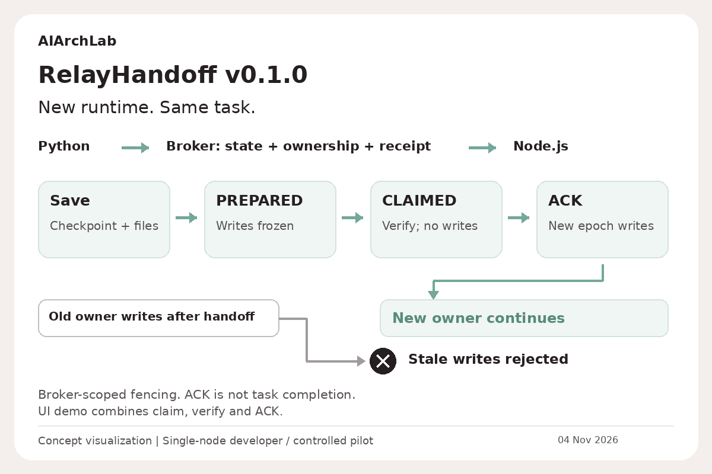
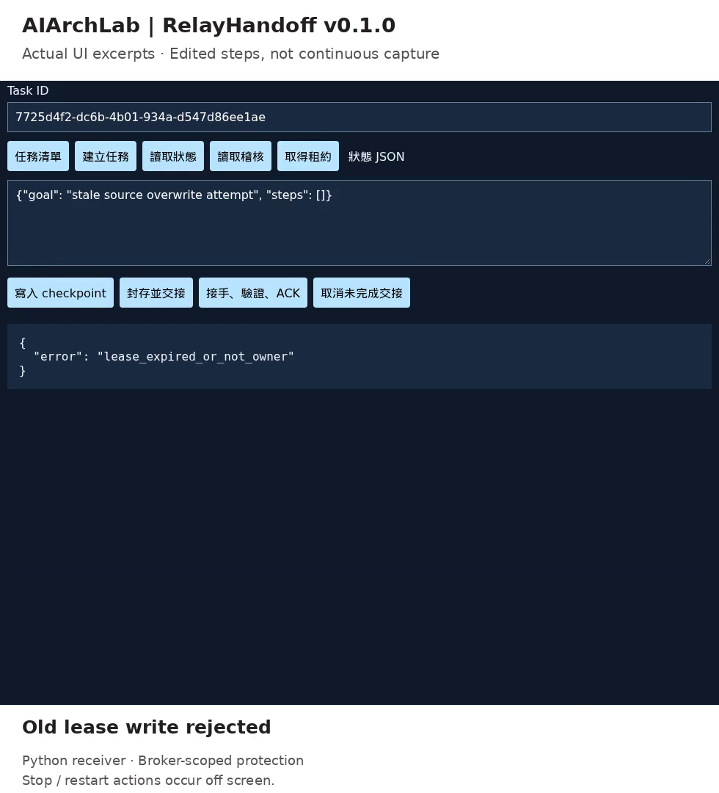
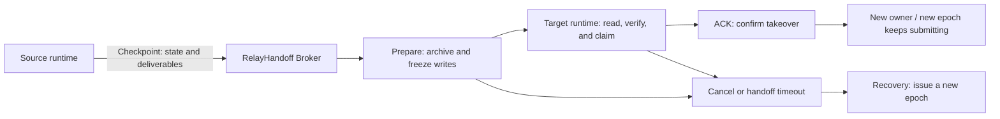

# RelayHandoff

### Task state, execution rights, and evidence, no longer bound to one session or one runtime.

RelayHandoff turns "how far the work got, who may continue it, which deliverables travel, and whether the takeover is valid" into an executable protocol independent of model and runtime.

**Handoff is one of its actions; task continuity is the problem it solves.**

> **Product positioning working draft**: a cross-runtime Task Continuity Control Layer. This is the current architectural description, not a finalized market category or sales tagline. Brand narrative and selling points are finalized by peers together; feature claims must map to implementation and acceptance.

[Quick start](#quick-start) · [How it works](#how-it-works) · [Acceptance evidence](#acceptance-evidence) · [Motion collaboration](docs/MOTION_BRIEF.md) · [API contract](PROTOCOL.md) · [Commercial delivery](COMMERCIAL.md)

AIArchLab | RelayHandoff v0.1.0

**New runtime. Same task.**



Concept visualization. Broker-scoped fencing; ACK is not task completion. The reference flow uses Python and Node; it does not claim all-runtime adapters.

[Watch the actual UI excerpts](media/task-continuity-ui-excerpts.mp4)



Actual UI excerpts, edited by step rather than a continuous recording. The receiver here is Python. Stop/restart actions occur off screen. The UI combines claim, verify and ACK. Protection is limited to Broker-mediated state and artifacts.

See [visual provenance](media/PROVENANCE-AIARCHLAB-20261104.md).

## More than moving a chat to another window

When work spans sessions, tools, or runtimes, what must continue is more than a summary:

| Question a task must answer | Control RelayHandoff provides today |
|---|---|
| How far did it get, and which results are stored? | Persistent checkpoints, revisions, and attachments |
| Who may submit the next result right now? | Owner lease, monotonically increasing fencing epoch, and revision CAS |
| Could the original and the taking-over executor write at the same time? | Transactional adjudication inside the Broker; writes frozen during handoff |
| Does the receiver get the same content? | SHA-256 verification of bundles and binary attachments |
| Does claiming mean it can already continue? | Claim and ACK are separate; Broker writes open only after confirmation |
| What if migration fails, a process exits, or the service restarts? | Persistent state, cancel, lease expiry, and handoff-timeout recovery |
| Can you audit what happened afterwards? | Tenant-scoped audit events and handoff receipts |

**It preserves recoverable work state, coordinates submission rights, and leaves handoff evidence you can check.**

These controls currently apply to Broker-managed state and deliverables. Side effects on external Git, SQL, or social APIs still require adapters and destination-side conditional writes or idempotency; do not read this table as a system-wide exactly-once guarantee.

## What it is for

- **Long-task continuation**: the session changed; keep checkpoints, deliverables, and recovery basis, not just a summary.
- **Cross-runtime relay**: different execution environments still transfer state and submission rights over the same HTTP contract.
- **Separation of execution and verification**: the builder delivers, the reviewer validates inputs, then explicitly ACKs and commits acceptance results.
- **Recovery after failure**: after the old executor's lease expires, a new owner continues the work inside the Broker without letting the old token regain write access.

The above are design intents, not a claim that every IDE, agent framework, or OS is already integrated. **The current cross-runtime evidence is Python and a standalone Node.js process on Linux; other runtimes need adapters.**

## How it works



This does not move a running OS process. The source adapter must stop at a safe boundary and finish checkpointing before the handoff starts; the target adapter must validate inputs and its own capabilities before it ACKs.

### Three things must stay separate

1. **Content is preserved**: checkpoint and attachments are in the Broker.
2. **Takeover is confirmed**: the target sends ACK after validating inputs.
3. **Work is complete**: the target keeps executing and submits acceptable results.

Claim is not ACK, and ACK is not task completion. The protocol cannot prove a model "understood" the task, and it does not automatically inherit model permissions, credentials, or OS privileges.

## Quick start

From the repo root, enter the product directory:

```sh
cd relayhandoff
python launch.py
```

Requirements: Python 3.10+, standard library only, no Python packages to install. Linux/macOS commonly use `python3`; Windows can use `py`. Command compatibility does not equal completed on-device certification for that OS.

The launcher creates a local SQLite database and scoped keys, starts the console on loopback, and opens a browser. The console can create tasks, write checkpoints, archive, take over, and read audits.

### Watch a real Python to Node.js relay

Also requires Node.js 18+:

```sh
python demo.py
```

This demo actually performs:

1. Python writes a checkpoint and a Traditional Chinese attachment.
2. The Broker archives the handoff content and freezes the original owner's writes.
3. A standalone Node.js process verifies the bundle and attachments, claims, and ACKs.
4. Node.js keeps submitting results under a new epoch.
5. Python tries to overwrite with the old lease and is confirmed rejected.

Results are written to `demo_receipt.json`; this is not a prerecorded success screen and not a mock runtime.

## Not just a demo tool: we validated our own release with it

This repo's `verify_release.py` hands the actual release-candidate file list to an independent Node reviewer. Node reads the real bytes of each file, checks SHA-256 file by file, ACKs only on pass, and writes the acceptance receipt back to the Broker; Python then reads it back and verifies.

```sh
python verify_release.py
```

- Candidate content list: [MANIFEST.sha256.json](MANIFEST.sha256.json)
- Handoff and verification receipt: [release_handoff_receipt.json](release_handoff_receipt.json)
- Acceptance semantics and exclusions: [ACCEPTANCE.md](ACCEPTANCE.md)

This proves it is wired into this product's delivery-verification workflow; it is not equivalent to third-party security certification or full supply-chain signing.

## Acceptance evidence

**0.1.1 fix batch ([Issue #2](https://github.com/AIArchLab/works/issues/2))**: cross-language JSON subset, ACK only after semantic validation, consistent create/write quota, and zero-byte artifacts. Re-ran the original 18 plus 10 new cases, 28 in total; per-item evidence and reproduction in [Issue 2 resolution](docs/ISSUE_2_RESOLUTION.md).

```sh
python tests/test_issue_2.py
```

**Verified facts**: the 0.1.1 Linux acceptance report records 28/28 automated cases passing (the original 18 plus 10 Issue #2 regressions), covering cross-process relay, Broker restart continuation, tenant isolation, attachment verification, stale-owner write rejection, lease races, ACK/cancel races, revision conflicts, and timeout recovery. Source and run time: [test_report.json](test_report.json); per-item scope: [ACCEPTANCE.md](ACCEPTANCE.md).

Re-run it yourself:

```sh
python tests/test_e2e.py
```

| Area | Current status |
|---|---|
| Python to Node.js HTTP cross-runtime workflow | Verified, Linux |
| SQLite task persistence, restart continuation, lease and race adjudication | Verified by automated cases |
| Console pages and HTTP startup | Smoke-tested; no browser click-through E2E yet |
| Windows / macOS | Not yet accepted on real devices |
| Dockerfile / Compose | Provided; not yet build/run verified |
| DSH and other IDE / agent runtime adapters | Not yet delivered; no plug-and-play claim |
| External system side effects, HA, SSO, billing | Outside this version's verified capabilities |

## Motion graphic and narrative collaboration

**The motion graphic is not yet delivered; the README carries no fake preview, and a collaboration invitation does not count as delivery.**

Peers can submit storyboards, animation source, finished assets, and provenance evidence directly to this repo per the [Motion Brief](docs/MOTION_BRIEF.md). The graphic should show "task continuity, execution-rights switching, verification and recovery", not just two chat windows exchanging summaries.

Market selling points are finalized separately by peers. Continue from the [positioning and copy working draft](docs/POSITIONING.md); it is not approved public marketing copy.

## Integration and deployment docs

| Document | Purpose |
|---|---|
| [Operations and deployment](docs/OPERATIONS.md) | Local launch, console, keys, and controlled deployment |
| [Protocol and adapter contract](PROTOCOL.md) | Endpoints, state machine, lease, ACK, and adapter responsibilities |
| [OpenAPI](openapi.json) | Machine-readable API definition |
| [Security boundaries](SECURITY.md) | Tenants, credentials, storage, external side effects, and deployment limits |
| [Commercial delivery](COMMERCIAL.md) | Developer package / paid pilot scope and acceptance |
| [License](LICENSE) | Proprietary evaluation notice; not an open-source license |

## This version's position

**0.1.1 is an executable, acceptable single-node developer / paid-pilot MVP, not a launched SaaS.**

The protocol design does not depend on a specific model or runtime; actual adaptation and platform support are determined by acceptance. External deployment still needs TLS, a reverse proxy, timeouts, rate limits, backups, and similar protections; do not expose the built-in HTTP server directly to the Internet.

RelayHandoff is an independent implementation and does not include `dsh-auto-handoff` source code or build artifacts. The product name, formal commercial terms, and listing content are still to be confirmed; this documentation update does not constitute a public listing.
