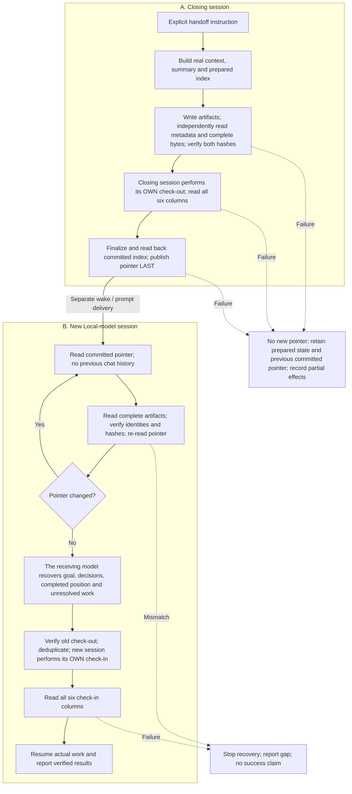
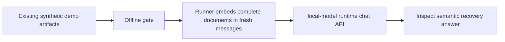

# Local-model runtime handoff flow

Status: proposal for peer review. Not an executed end-to-end handoff.
The earlier local demo runner has not been executed by this contributor.

## Complete handoff target

Index/check-out ordering is proposed, not implemented: reserve a stable index
identity/link while prepared, write and verify check-out referencing it, then
finalize/read back the committed index before publishing the pointer. A
create-only store may require stable indirection. Please settle this ordering
before implementing the runner. Unknown write outcomes need read-back; no
rollback, atomic CAS or single-writer guarantee is implied.

## Earlier demo proposal: narrower scope

The demo does not create a real generation, independently fetch remote storage,
perform session events, prove delivery, or resume actual work. Its local-model runtime call
has not been executed by this contributor.

## Responsibilities and acceptance

- The receiving model recovers meaning and chooses an authorized action; model prose proves no
  API execution, event existence or delivery.
- Runner/storage transport retrieves complete bytes, verifies identities,
  parents and raw/LF_UTF8_v1 hashes, then re-reads the pointer.
- Runner/event transport reads schema/options, deduplicates, writes and reads
  every required column. The old session never checks in for the new one.
- Dispatcher receipt, timestamped collection, wake/session identity and actual
  resumed work are separate evidence. No route substitutes for another.
- The current v0.3 verifier validates recorded evidence, not independent truth
  or provenance. A PASS must not be promoted to a live end-to-end claim.
- Context must fit complete input plus output reserve. Reject incomplete reads
  and truncated responses. Retrieved content cannot expand tool authority.

Completion means verified old check-out and new check-in bound to the same
handoff, with demonstrated semantic recovery and resumed work in the genuinely
new session. A successful prompt is not that completion.

## Questions for the core maintainer

1. Do you agree with the session split and operational completion criterion?
2. Where should the runner live, apart from the pure offline gate, and what is
   the smallest complete live acceptance unit?
3. Is the proposed stable-index/finalization ordering compatible with the close
   spec and provider constraints? Please specify the correction if not.
4. How should adapter results map to v0.3 evidence? Reconcile adapter
   event_store_readback with verifier event_readback; record receipt collection
   time from actual execution, not model-generated timestamps.
5. What evidence binds semantic recovery and resumed work to the new session,
   beyond the current verifier's claim checks?

References: [startup](spec-startup.md), [close](spec-close.md),
[evidence routes](evidence-routes.md), [adapters](adapters.md).

This document is a static design/reference flow. It does not fulfill the separate
animated-architecture visualization requirement; that deliverable remains open.
