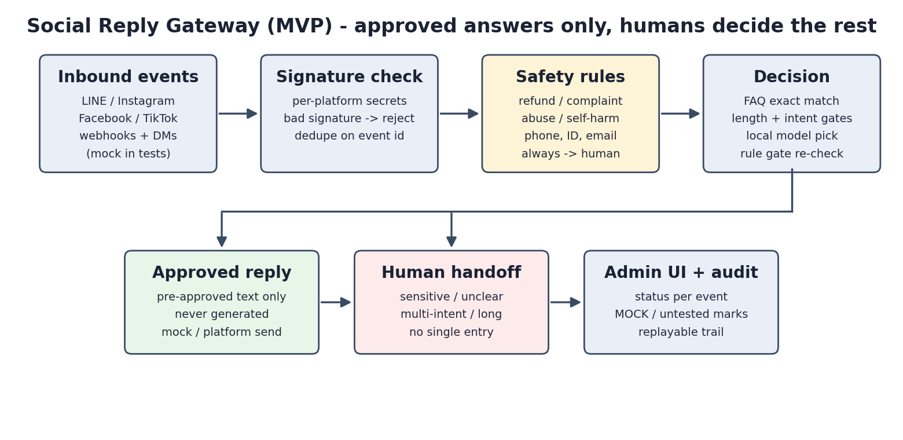

# Social Reply Gateway (MVP)

Founder, AIArchLab

A small, reusable gateway that takes comments and direct messages from social platforms, decides whether to answer, and either sends an approved answer or hands the message to a person. Every event is tracked in an admin UI with its status and audit trail.

Flow: inbound event -> signature check -> normalize and dedupe -> safety check -> decide -> send or hand off -> admin UI.

Demo video (56 s, recorded on v8 with the new rule gate; mock send endpoints, real local model; not a complete end-to-end run): [demo.mp4](demo.mp4)

## Background story (fictional)

A small food shop gets the same questions every day across LINE, Instagram, Facebook and TikTok: opening hours, set-menu prices, booking a private room. The owner wants fast answers, but never wants a machine to invent a promise. This gateway only ever sends answers the owner pre-approved; anything unusual, sensitive or ambiguous goes to a person. Every decision lands in an audit trail the owner can replay. All scenario data in this repository is fictional.

## Status (read this first)

- **No real platform has been connected.** No real webhook was received and no real reply was sent to LINE, Instagram, Facebook or TikTok. Every platform capability is marked "untested" in the admin UI.
- All send paths were exercised only against a local mock endpoint with test keys. The admin UI shows `MOCK` for those destinations. A `sent` status there does not mean a platform delivered anything.
- **The AI part is real but small.** It runs a local Qwen2.5-1.5B-Instruct model (Apache-2.0, CPU, no cost). It never writes reply text. It can only pick one of the approved answers you configure, and a rule layer checks the result again.
- The end-to-end path (real platform, real AI, real customer message) is **not complete**.
- TikTok is a placeholder. Facebook comment-thread replies and DMs are disabled by default. Instagram private reply is not implemented.

## How decisions work

1. Safety words and patterns (refund, complaint, abuse, self-harm, phone, ID and email patterns) always go to a person. Rules can add words, not remove them.
2. FAQ rules answer only when the whole message is covered by a rule key.
3. Messages with more than one intent, or longer than 120 normalized characters, go to a person.
4. For the rest, a local model runs two constrained calls: it picks an entry id (grammar-forced digits), then answers yes or no to "is this message only about this topic". Output is parsed strictly.
5. After a model "yes", a rule gate checks that the whole message is made of the entry's own approved wording, polite filler and (for price entries) price words. Any leftover word, any connector such as "also" or "and", or a match on two entries sends it to a person. This gate does not depend on the model.
6. Outbound text is always an approved answer, never generated. Answers longer than 500 characters are rejected when rules are saved.

Retry policy: 2xx is sent. 401 and 403 are `failed_auth`. 429 is `failed_rate_limited`. Timeouts and 5xx are `failed_unconfirmed` and are never retried automatically, because the reply may already be visible. There is no push fallback.

## Evidence

`evidence/real_llm_evidence_v8_full.jsonl` has one row per probe from a single run of `tests/real_llm_probe_suite.py` (94 unique queries, greedy decoding, one small model, hand-written probes). Results:

- 66 queries that must not get a reply: 0 replies.
- 28 queries that should get the approved answer: 17 replied correctly, 11 went to a person, 0 wrong texts.

This is a safety-first result on a small hand-written set. It is not a benchmark and not a claim of accuracy. Recall is limited on purpose.

## Run

Tests (standard library only, mock platforms): `python3 tests/run_all.py`

Run the server: copy `config.example.json` to `config.json`, set real values (placeholder tokens are rejected at startup), then `SRG_CONFIG=config.json python3 -m srg`. Open `/?t=<admin_token>` once; it sets an HttpOnly cookie. Never put secrets in the repository.

Docker: from the repository root, `docker build srg/` (the Dockerfile uses the `srg/` folder as build context). The Docker image was not built or run as part of this work's verification.

Local model: install `llama-cpp-python`, download `qwen2.5-1.5b-instruct-q4_k_m.gguf` from the official Qwen GGUF repository, save it as `models/q15.gguf`, then run `python -m unittest tests.test_real_local_llm` and `python tests/real_llm_probe_suite.py`. `Dockerfile.llm` builds an image with the model.

## License

MIT (see the repository root LICENSE). The Qwen model is not part of this repository and has its own Apache-2.0 license.
