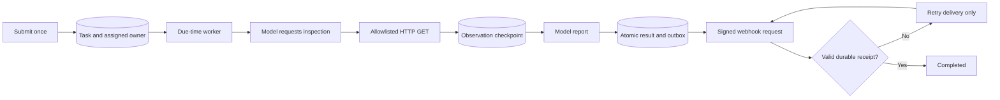

# Taskloop

**A durable agent task is not complete until its result reaches a recipient inbox.**

**Why this work is here.** Taskloop is a sample of engineering discipline - tests, de-identification, and verifiable delivery - not a showcase of technical difficulty. It is written for clients evaluating governance and delivery quality.

Runnable MVP · Sanitized Example · Python 3.10+ · Standard library only · MIT

Taskloop implements one bounded use case: schedule an HTTP status check, let a configured
model request the read-only inspection and produce a report, persist the result, and deliver
it to a signed, idempotent webhook inbox. Restarting the worker does not erase the task.

## What actually runs

- Explicit task ID, assigned owner, timezone-aware due time, target, expected status and recipient.
- Real model adapter: OpenAI-compatible chat completions or Vertex generateContent REST.
- A bounded `inspect → observation → report` model/tool loop; the model cannot change the target.
- SQLite durable task state, observation checkpoints and transactional notification outbox.
- Exclusive leases across processes sharing the same local database.
- Retried webhook delivery with a stable event ID, signed requests and payload-bound signed receipts.
- Separate execution, delivery and final states. An HTTP 200 without the expected receipt is not completion.
- Example recipient durably stores one inbox item per event, even when requests are repeated.



The worker must be running on a host you control. The database must be on persistent local
storage. This is not a promise that closing a laptop or reclaiming an ephemeral sandbox keeps
its worker alive. Restart the process with the same database to resume overdue tasks.

## Try it without credentials

From this directory:

```bash
python3 -m taskloop --version
python3 -m unittest discover -s tests -v
python3 examples/smoke.py
```

The smoke command starts a real local HTTP endpoint and durable webhook inbox. Its default
agent is an **explicit deterministic test double**, not a model. It forces the first delivery
to return 503, reopens the task database, retries the notification and checks one accepted event.

## Run with a real model

Configure a compatible endpoint and credentials in environment variables; never put tokens
in task URLs, source files, manifests or the database.

```bash
export TASKLOOP_AGENT_PROVIDER=openai
export TASKLOOP_MODEL_URL=https://YOUR_MODEL_HOST/v1/chat/completions
export TASKLOOP_MODEL=YOUR_MODEL
export TASKLOOP_MODEL_TOKEN=YOUR_RUNTIME_TOKEN
python3 examples/smoke.py --live
```

For Vertex, set `TASKLOOP_AGENT_PROVIDER=vertex` and `TASKLOOP_MODEL_URL` to your model's
`generateContent` endpoint. `TASKLOOP_METADATA_AUTH=1` explicitly enables runtime metadata
credentials instead of a static token. Tokens supplied directly must be refreshed by the operator.
The live smoke uses a real configured model and resumes notification delivery in a new process.
Model/API usage is recorded; it is not claimed to be free.

## Submit a scheduled task

For the local example, keep this recipient running in one terminal:

```bash
export TASKLOOP_WEBHOOK_SECRET=$(python3 -c 'import secrets; print(secrets.token_hex(32))')
# Use the same secret in the worker terminal through your normal secret distribution.
python3 -m taskloop --db inbox.sqlite3 receiver --port 8765
```

Submit once, supplying your actual timezone-aware due time:

```bash
python3 -m taskloop --db tasks.sqlite3 submit \
  --id sample-check-001 --owner sample-agent \
  --target http://127.0.0.1:8765/health --expected 200 \
  --webhook http://127.0.0.1:8765/inbox \
  --due '2030-01-01T09:00:00+08:00'
```

With real model credentials and the shared webhook secret configured, start the worker:

```bash
python3 -m taskloop --db tasks.sqlite3 worker \
  --allow-host 127.0.0.1 --allow-local-demo
```

The date above is illustrative, not a test that ran in 2030. Replace it with the desired due time.
The explicit local-demo flag permits loopback HTTP for this demonstration. Production tasks
require HTTPS and exact allowlisted public hosts. The example receiver is an integration
reference: place it behind an authenticated HTTPS boundary before exposing it publicly.

Inspect the persisted result and audit trail:

```bash
python3 -m taskloop --db tasks.sqlite3 status sample-check-001
python3 -m taskloop --db tasks.sqlite3 events sample-check-001
```

`worker --once` performs one bounded execution/delivery tick for an external supervisor.
No conversational history is needed to resume an existing task ID.

## Completion means what?

| State | Meaning |
|---|---|
| EXECUTION_PENDING | Pending, retrying or running execution; not complete |
| AWAITING_DELIVERY | A result exists; no valid recipient receipt yet |
| DELIVERY_BLOCKED | Notification retries exhausted; intervention required |
| COMPLETED | Inspection/report succeeded and the recipient durably acknowledged this result |
| FAILED_REPORTED | Execution exhausted retries and its failure report reached the recipient |

The check verdict (`PASS` / `FAIL`) is computed from observed versus expected HTTP status,
not from model prose. A reported unhealthy endpoint can be a completed inspection task.
The signed receipt proves acceptance by the configured recipient, **not a human reading it**.
This MVP does not deliver into an arbitrary chat application or send email by itself; use a
recipient adapter that implements the documented receipt contract.

## Receipt contract

Worker POST body is an immutable JSON event with `event_id`, `task_id`, `owner`, `kind` and `result`.
Headers include `Idempotency-Key`, `X-Taskloop-Time` and `X-Taskloop-Signature`.
The request signature is HMAC-SHA256 over `timestamp + "." + body`.

The receiver commits the inbox item before returning a 2xx JSON body:

```json
{"accepted":true,"event_id":"sample-check-001:result:v1","receipt_id":"receiver-generated-id","payload_sha256":"sha256-of-exact-request-body"}
```

It signs the exact response bytes with the same secret in `X-Taskloop-Signature`.
Replaying the same event returns its existing receipt. Reusing its ID with changed bytes returns
409. An unsigned, wrong-event or wrong-payload response is not accepted by the worker.

## Recovery and limits

- A checkpointed observation is reused after a crash; a finalized result is never re-executed merely
  because notification failed. Result and outbox creation are one SQLite transaction.
- A crash after a remote side effect but before a local commit has an uncertainty window.
  Consequently this MVP only executes safe HTTP GET checks and uses **at-least-once delivery**
  plus receiver deduplication. It does not claim universal exactly-once side effects.
- SQLite is for a single host with persistent local storage. Do not put it on a shared network
  filesystem or treat local leases as distributed coordination across machines.
- Retries are bounded (five attempts by default); blocked notifications do not turn green.
  Failed/blocked tasks remain queryable. There is no independent escalation channel yet.
- Requests are capped, redirects are not followed, private/link-local destinations are blocked,
  and the network connection uses the checked address rather than resolving twice.
- No arbitrary shell tools, write-capable business operations, multi-tenant service, scheduler HA,
  cross-host failover, public receiver authentication UI, or full security certification is included.
- Keep the worker directory and SQLite files private. Back up the database and preserve the
  shared secret outside source control. Model outputs are untrusted summaries, not evidence.

## Evidence

See [`evidence/live_smoke.json`](evidence/live_smoke.json) for an actual remote-model run
against a synthetic local endpoint: two model decisions, one HTTP GET, first delivery 503,
new-process recovery, two notification requests, one persisted inbox event and a valid receipt.
See [`evidence/unit_tests.txt`](evidence/unit_tests.txt) for the test run. This is a test result,
not a production SLA or a claim about customer workloads.
